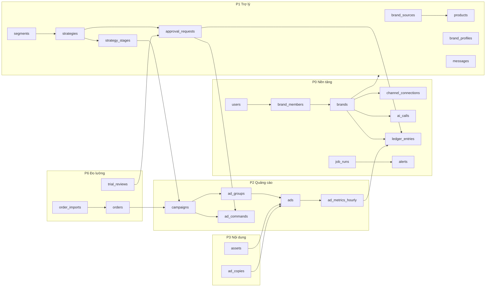
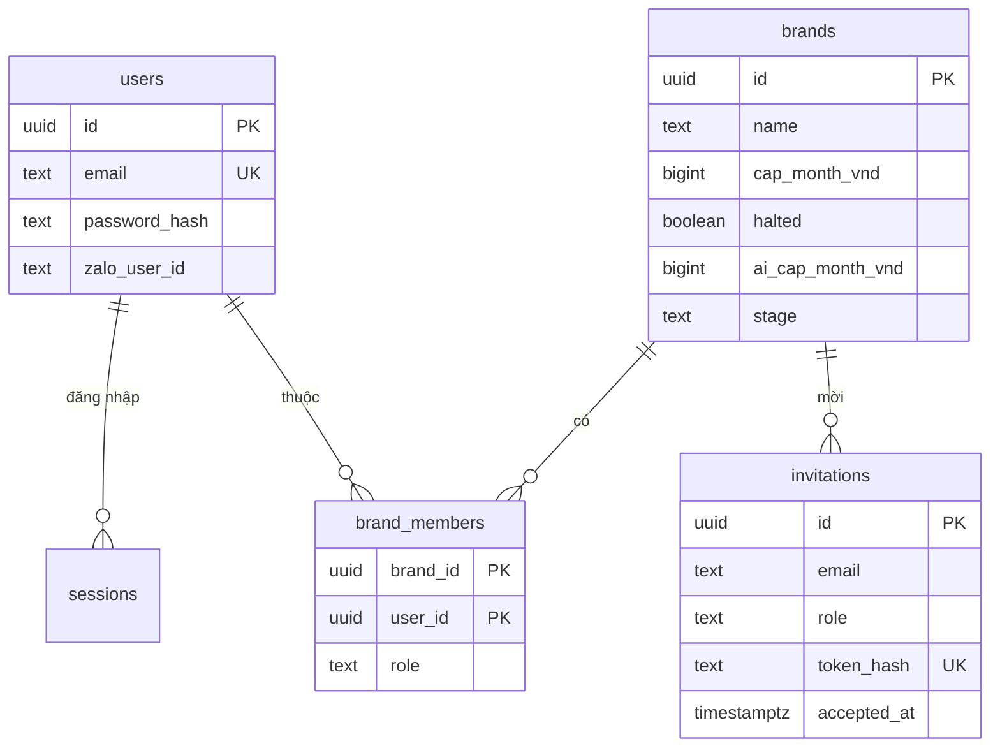
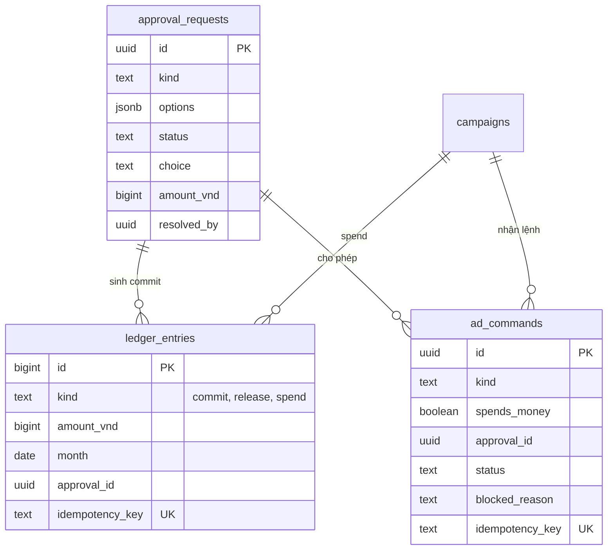
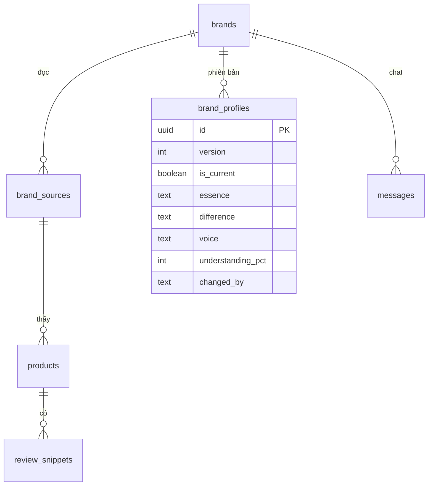
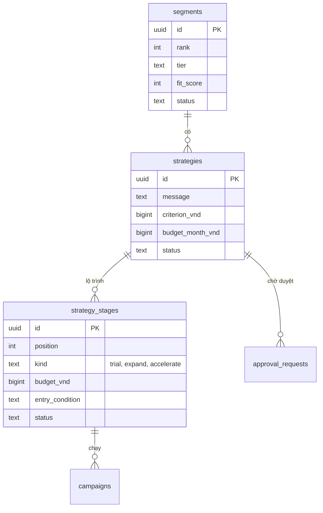
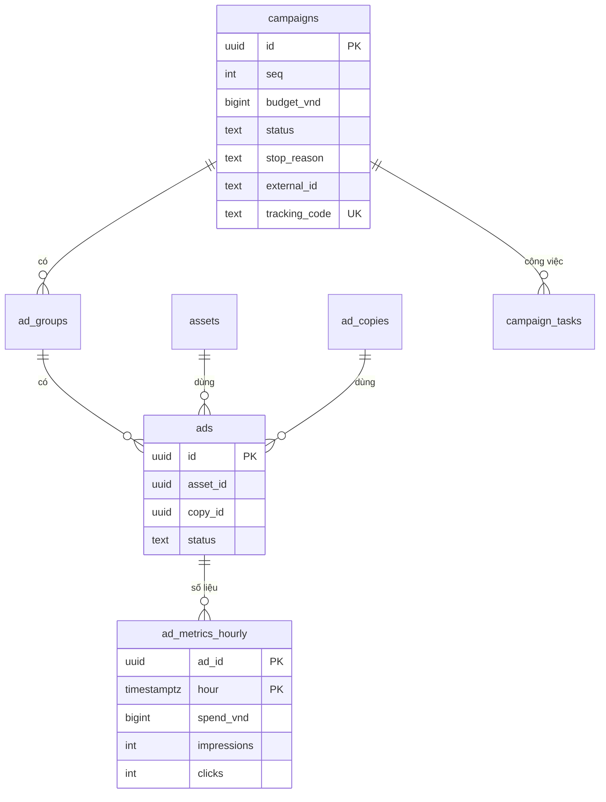

# Thiết kế cơ sở dữ liệu Z.MKT

Trạng thái: **đã duyệt 13/11/2026**, đang áp từng bước. Tiến độ ở mục 10.

- DDL đầy đủ cho MVP: [`db/schema.v3.proposed.sql`](../db/schema.v3.proposed.sql) (31 bảng, 3 view, đã nạp thử trên Postgres và thử các ràng buộc tiền).
- Bản đang chạy: [`db/schema.sql`](../db/schema.sql) (v3, bước 3 trên 5).
- v1.0 và v1.1 ở mục 6: thiết kế ở mức bảng và cột chính, DDL viết khi bắt đầu phiên bản đó.

Cuối tài liệu có **6 điểm cần bạn quyết** (mục 9).

## 1. Nguyên tắc

| Nguyên tắc | Cách làm |
|---|---|
| Một nguồn sự thật cho tiền | Mọi con số "đã duyệt", "đã chi", "còn trong trần" tính từ một bảng `ledger_entries`. Không bảng nào khác giữ số dư. |
| Tiền không sai số | `bigint` đơn vị VND. Chi phí AI lưu micro-USD kèm số VND đã quy đổi lúc gọi. |
| Sổ chỉ thêm | `ledger_entries` và `audit_events` có trigger chặn sửa và xoá. Đổi quyết định là thêm một dòng `release`. |
| Không duyệt thì không chi | Dòng `commit` bắt buộc có `approval_id`. Lệnh làm tăng tiền gửi sang Meta bắt buộc có `approval_id`. Ràng buộc nằm trong cơ sở dữ liệu, không chỉ trong code. |
| Tách theo thương hiệu | Mọi bảng nghiệp vụ có `brand_id`. Quyền đi qua `brand_members`. Viết RLS được ngay khi lên Supabase. |
| Lịch sử thay cho ghi đè | Hồ sơ thương hiệu có phiên bản. Việc chờ duyệt giữ lại lựa chọn và người duyệt. |
| Chạy lại không ghi trùng | Việc nền ghi sổ và gửi lệnh bằng `idempotency_key` duy nhất. |
| Dễ thêm trạng thái | Trạng thái là `text` + `check`, không dùng enum của Postgres. |

## 2. Bản đồ tổng thể



Dòng chảy chính: **hồ sơ → nhóm khách → chiến lược → việc chờ duyệt → sổ tiền giữ chỗ → lệnh đẩy chiến dịch → số liệu mỗi giờ → sổ tiền ghi đã chi → đơn hàng ghép về → tổng kết chạy thử → việc chờ duyệt mới.**

## 3. Từng nhóm bảng (MVP)

### 3.1 Tài khoản và thương hiệu (B2)



| Bảng | Dùng để | Ghi chú |
|---|---|---|
| `users` | Người đăng nhập | Mật khẩu băm scrypt. Email duy nhất không phân biệt hoa thường. |
| `sessions` | Phiên đăng nhập | Chỉ lưu băm của token. Có `brand_id` đang mở. |
| `brands` | Thương hiệu | Giữ trần tháng, trần AI, cờ dừng chi. Không xoá, chỉ `archived_at`. |
| `brand_members` | Ai thuộc thương hiệu nào | 4 vai: `owner`, `approver` (duyệt được tiền), `member`, `viewer`. |
| `invitations` | Mời thành viên qua email | Token dùng một lần, có hạn. |

Thay đổi so với v2: `brands.owner_id` chuyển thành một dòng `owner` trong `brand_members`, để một thương hiệu có nhiều người.

### 3.2 An toàn tiền (B4, Q3)



Ba cửa, cả ba đều ở tầng dữ liệu:

1. **Duyệt.** `ledger_entries.kind = 'commit'` phải có `approval_id`. `ad_commands.spends_money = true` phải có `approval_id`.
2. **Trần.** Trigger `check_commit` khoá dòng thương hiệu rồi cộng `commit − release` của tháng. Vượt `cap_month_vnd` thì từ chối.
3. **Nút dừng.** Cùng trigger đó từ chối mọi `commit` khi `brands.halted = true`. Việc nền chỉ gửi lệnh `pause` và `stop` khi đang dừng.

Đã thử trên Postgres: duyệt 25 tr rồi duyệt thêm 10 tr bị từ chối, cam kết không có lần duyệt bị từ chối, cam kết khi đang dừng bị từ chối, sửa và xoá dòng sổ bị từ chối, lệnh `launch` không có lần duyệt bị từ chối.

`ledger_entries.month` là tháng mà khoản tiền tính vào trần. Một lần duyệt "15 triệu mỗi tháng" sinh một dòng `commit` cho mỗi tháng nó chạy, do việc nền đầu tháng ghi.

Tự dừng khi chạm trần (Q3): việc nền `enforce_cap` đọc view `brand_budget_month`. Khi `spent_vnd` sắp chạm trần, nó ghi `ad_commands(kind='pause', reason='cap')` và một `alerts`.

### 3.3 AI và chi phí (B3)

`ai_calls`: mỗi lời gọi một dòng, có `brand_id`, `purpose`, `model`, số token (kể cả token đọc và ghi cache), `cost_usd_micro`, `cost_vnd`, `status`. Trước khi gọi, ứng dụng đọc view `brand_ai_month`; quá `brands.ai_cap_month_vnd` thì không gọi và ghi một dòng `status = 'blocked_by_cap'`.

Các bảng do AI sinh ra (`messages`, `segments`, `ad_copies`, `trial_reviews`) có `ai_call_id` để truy ngược chi phí và mô hình.

### 3.4 Kết nối kênh (A3, B6)

`channel_connections`: một dòng cho mỗi tài khoản đã nối. `kind` ở MVP: `meta_ads`, `shopee`, `website`, `orders_csv`. `access_level`: `full`, `read`, `link` (đúng ba nhãn trên màn Kết nối).

Token lưu ở `token_ciphertext` + `token_nonce` + `token_key_version`, mã hoá AES-256-GCM. Khoá nằm trong biến môi trường hoặc kho bí mật, không nằm trong cơ sở dữ liệu. `token_key_version` để xoay khoá mà không phải giải mã lại tất cả cùng lúc.

### 3.5 Việc nền và cảnh báo (B5)

| Bảng | Dùng để |
|---|---|
| `job_runs` | Mỗi lần chạy của một việc nền: tên việc, trạng thái, lần thử, lỗi, số liệu. Inngest lo lịch và thử lại; bảng này để tra cứu và hiện trong ứng dụng. |
| `alerts` | Cảnh báo cần gửi cho người: việc lỗi, chạm trần, token hết hạn, có việc chờ duyệt. Kênh `zalo`, `email`, `in_app`. |
| `audit_events` | Ai (người, AI, hệ thống, việc nền) làm gì, lúc nào. Chỉ thêm. |

### 3.6 Hồ sơ thương hiệu (A1, A2)



| Bảng | Dùng để |
|---|---|
| `brand_sources` | Link shop, website, file mà Z.MKT đã đọc, kèm trạng thái và số sản phẩm, đánh giá đã thấy. |
| `products` | Sản phẩm đọc được: tên, giá, số đánh giá, điểm. |
| `review_snippets` | Trích đoạn đánh giá có gắn chủ đề ("làm quà", "vẽ tay"), làm bằng chứng cho hồ sơ và nhóm khách. Không lưu toàn bộ đánh giá. |
| `brand_profiles` | Hồ sơ có phiên bản. Mỗi lần sửa trong chat thêm một phiên bản, trỏ về tin nhắn đã gây ra thay đổi. Chỉ một dòng `is_current` cho mỗi thương hiệu. |
| `messages` | Chat. Có `route` (màn người dùng đang xem) và `meta` (nhãn, thẻ link, thẻ kết quả). |

### 3.7 Thị trường và chiến lược (A4, A5, A6, A7)



- `segments`: nhóm khách theo thứ tự ưu tiên (`rank`), độ hợp (`fit_score`), ai, vì sao, khoảng trống.
- `strategies`: thông điệp, kênh, mục tiêu đơn, tiêu chí chi phí mỗi đơn, ngân sách tháng.
- `strategy_stages`: lộ trình Thử → Mở rộng → Tăng tốc, mỗi giai đoạn có ngân sách và điều kiện để bước vào. Đây là dữ liệu của bảng lộ trình trên màn Chiến lược.
- `approval_requests`: **mọi thứ màu cam trên giao diện là một dòng `status = 'pending'` ở đây.** `options` giữ các lựa chọn kèm số tiền ("Chạy thử 5 tr", "Tăng lên 15 tr/tháng", "Dừng hẳn"). Khi người dùng chọn: ghi `choice`, `resolved_by`, rồi ghi `commit` vào sổ trong cùng một giao dịch.

### 3.8 Nội dung (N1, N2)

- `assets`: ảnh và video trong thư viện. File nằm ở kho file, bảng giữ đường dẫn, kích thước, thời lượng. `origin`: `upload`, `shop`, `ai` (dành cho v1.0).
- `ad_copies`: lời quảng cáo AI viết. Có `profile_id` để biết viết theo phiên bản hồ sơ nào; hồ sơ đổi thì biết lời nào cần viết lại.

### 3.9 Quảng cáo (Q1, Q2, Q3)



- Ba tầng `campaigns → ad_groups → ads` khớp cấu trúc của Meta Ads, TikTok Ads và Google Ads, nên thêm kênh ở v1.0 không phải đổi bảng.
- `ads` là một cặp ảnh hoặc video với một lời quảng cáo. Tab Nội dung của chiến dịch đọc từ đây.
- `ad_commands`: hàng đợi lệnh gửi sang kênh. Ghi trước, gửi sau, kết quả ghi lại. Lệnh bị chặn có `blocked_reason`.
- `ad_metrics_hourly`: khoá chính `(ad_id, hour)`, kéo lại cùng một giờ thì ghi đè đúng dòng đó. Việc nền lấy chênh lệch chi tiêu theo ngày và ghi một dòng `spend` vào sổ với `idempotency_key = campaign:ngày`.
- `campaign_tasks`: tab Công việc (Chuẩn bị, Sản xuất, Chạy, Tối ưu), việc của Z.MKT và việc của người dùng.

### 3.10 Đo lường (D1, D2, D3)

- `order_imports`: mỗi lần nhập đơn (file CSV hoặc API), số dòng mới và số dòng ghép được.
- `orders`: đơn hàng. Duy nhất theo `(brand_id, source, external_id)` nên nhập lại file không sinh đơn trùng. `tracking_code` khớp với `campaigns.tracking_code` là cách ghép chính; `match_method` ghi lại cách đã ghép.
- View `campaign_daily`: mỗi chiến dịch mỗi ngày một dòng gồm đã chi, hiển thị, click, đơn, doanh thu. Màn tổng quan và biểu đồ theo ngày đọc từ đây.
- `trial_reviews`: tổng kết sau 2 tuần, có `findings` cho từng chiến dịch và `recommendation` (`expand`, `extend`, `stop`). Mỗi tổng kết sinh một `approval_requests`.

## 4. Story nào dùng bảng nào

| Story | Bảng |
|---|---|
| B1 Repo, kiểm thử, môi trường | Không có bảng. Migration đánh số trong `db/migrations/`. |
| B2 Đăng nhập, nhiều thương hiệu, mời | `users`, `sessions`, `brands`, `brand_members`, `invitations` |
| B3 Ghi chi phí AI, có trần | `ai_calls`, `brands.ai_cap_month_vnd`, view `brand_ai_month` |
| B4 Không chi khi chưa duyệt hoặc vượt trần, nút dừng | `approval_requests`, `ledger_entries`, `ad_commands`, `brands.halted`, view `brand_budget_month` |
| B5 Việc nền, báo lỗi về Zalo | `job_runs`, `alerts`, `users.zalo_user_id` |
| B6 Mã hoá token | `channel_connections.token_*` |
| A1 Đọc shop, dựng hồ sơ | `brand_sources`, `products`, `review_snippets`, `brand_profiles` |
| A2 Sửa hồ sơ trong chat | `messages`, `brand_profiles` (phiên bản mới) |
| A3 Nối kênh, chọn mức quyền | `channel_connections` |
| A4 Nhóm khách theo ưu tiên | `segments` |
| A5 Chiến lược và lộ trình trong trần | `strategies`, `strategy_stages` |
| A6 Duyệt hẳn hoặc chạy thử | `approval_requests`, `ledger_entries` |
| A7 Việc chờ hiện màu cam | `approval_requests` (`pending`), `campaign_tasks` (`waiting_user`) |
| Q1 Đẩy chiến dịch lên kênh | `campaigns`, `ad_groups`, `ads`, `ad_commands` |
| Q2 Kéo số liệu mỗi giờ | `ad_metrics_hourly`, `ledger_entries` (`spend`), `job_runs` |
| Q3 Tự dừng khi chạm trần | `ad_commands` (`reason = 'cap'`), `alerts` |
| N1 AI viết lời quảng cáo | `ad_copies`, `ai_calls` |
| N2 Thư viện ảnh, video | `assets` |
| D1 Ghép đơn về chiến dịch | `order_imports`, `orders`, `campaigns.tracking_code` |
| D2 Tổng quan chiến dịch theo ngày | view `campaign_daily` |
| D3 Đề xuất mở rộng hay dừng | `trial_reviews`, `approval_requests` |

## 5. Quyền truy cập

Hiện tại tầng API kiểm tra: phiên hợp lệ, và thương hiệu thuộc người đăng nhập. Khi lên Supabase bật thêm RLS, cùng một mẫu cho mọi bảng có `brand_id`:

```sql
alter table campaigns enable row level security;
create policy member_read on campaigns for select
  using (brand_id in (select brand_id from brand_members where user_id = current_user_id()));
```

| Vai | Xem | Chat, tải nội dung | Duyệt tiền, bấm dừng | Mời người, đổi trần |
|---|---|---|---|---|
| `viewer` | có | | | |
| `member` | có | có | chỉ bấm dừng | |
| `approver` | có | có | có | |
| `owner` | có | có | có | có |

Ai cũng bấm dừng được trừ `viewer`, vì dừng là thao tác an toàn. Bật lại và duyệt tiền cần `approver` trở lên.

## 6. Mở rộng cho v1.0 và v1.1

Thiết kế ở mức bảng. Phần lớn là bảng thêm mới; bảng MVP chỉ thêm cột hoặc thêm giá trị trạng thái.

### v1.0

| Story | Thay đổi |
|---|---|
| A8 Sức khoẻ thương hiệu | `brand_health_snapshots` (brand_id, taken_at, scores jsonb, mentions, findings, ai_call_id) |
| A9 Tăng ngân sách trong chat | Không có bảng mới: `approval_requests.kind = 'raise_budget'` sinh từ chat |
| A10 Gửi thêm link | Dùng `brand_sources`; thêm `brand_sources.strategy_id` |
| Q4 Thử nghiệm A/B | `experiments` (campaign_id, hypothesis, metric, status, winner_ad_id), `experiment_arms` (experiment_id, ad_id, share) |
| Q5 Tự tắt nhóm lỗ, chuyển ngân sách | `ad_commands.reason = 'optimize'` (đã có). Thêm `optimization_rules` (brand_id, kind, threshold, enabled) |
| Q6 Kênh thứ hai | Thêm giá trị `tiktok_ads` cho `channel_connections.kind` và `strategies.channel`. `strategies.channel` tách thành bảng `strategy_channels` (strategy_id, channel, budget_share) |
| N3 Số đơn và lượt xem của từng nội dung | View `asset_performance` từ `ads`, `ad_metrics_hourly`, `orders` |
| N4 AI tạo ảnh | `assets.origin = 'ai'` (đã có). Thêm `asset_generations` (asset_id, prompt, source_asset_id, ai_call_id) |
| I1 Hộp thư chung | `inbox_threads` (brand_id, connection_id, external_thread_id, customer_name, status, assigned_to, last_message_at), `inbox_messages` (thread_id, direction, sender, text, attachments, sent_at) |
| I2 AI trả lời, chuyển cho người | `inbox_messages.sender = 'ai'`, `inbox_threads.status = 'needs_human'`. Thêm `faq_entries` (brand_id, question, answer, source) |
| M1 Tự đăng ký, hướng dẫn | `onboarding_steps` (user_id, brand_id, step, done_at) |
| M2 Gói thuê bao, thanh toán | `plans`, `subscriptions` (brand_id hoặc account_id, plan_id, status, period_end), `invoices`, `payments`. Cần thêm `accounts` (xem điểm quyết số 3) |
| M3, M4 Kiểm thử | Không có bảng. `ad_metrics_hourly` phân vùng theo tháng trước kiểm thử tải |

### v1.1

| Story | Thay đổi |
|---|---|
| A11 Nối thêm sàn, ERP, đo lường | Thêm giá trị cho `channel_connections.kind` (`lazada`, `tiktok_shop`, `kiotviet`, `sapo`, `ga4`…). `sync_runs` (connection_id, kind, status, stats) |
| Q7 Kênh thứ ba | Thêm `google_ads`. Không đổi bảng |
| N5 Lịch đăng bài | `social_posts` (brand_id, connection_id, asset_id, caption, scheduled_at, status, external_id) |
| N6 AI làm video | `video_jobs` (brand_id, source_asset_ids, script, status, result_asset_id, ai_call_id) |
| I3 Tạo đơn từ hội thoại | `orders.source = 'inbox'`, `orders.thread_id`. Thêm `order_items` (order_id, product_id, variant_id, qty, price_vnd) |
| K1, K2 KOC | `kocs` (handle, platform, followers, niches), `koc_matches` (brand_id, koc_id, fit_score), `koc_deals` (brand_id, koc_id, terms, tracking_code, status). Đơn ghép về KOC bằng `tracking_code`, như chiến dịch |
| G1, G2 GEO | `geo_checks` (brand_id, assistant, question, asked_at), `geo_answers` (check_id, mentioned, cited_urls, excerpt), `geo_contents` (brand_id, topic, body, published_url) |
| C1 Đồng bộ giá, tồn kho, chính sách | `product_variants`, `inventory_levels` (variant_id, connection_id, qty, synced_at), `price_history`, `brand_policies` (kind, text). `products` thêm `sku`, `status` |
| D4 Báo cáo đa kênh | `attribution_touches` (order_id, channel, campaign_id, touched_at, weight). View `channel_revenue_daily` |

Hai chỗ MVP đã chừa sẵn để về sau không phải sửa lớn:
- `campaigns.tracking_code` là cơ chế ghép đơn chung. KOC và bài đăng mạng xã hội dùng lại đúng cách đó.
- `ad_commands` và `ledger_entries` không biết gì về Meta. Kênh thứ hai và thứ ba đi qua cùng ba cửa an toàn.

## 7. Chỉ mục, dung lượng, lưu giữ

| Bảng lớn nhanh | Ước lượng | Cách xử lý |
|---|---|---|
| `ad_metrics_hourly` | Mỗi mẫu quảng cáo 24 dòng một ngày. 1.000 thương hiệu × 20 mẫu ≈ 175 triệu dòng một năm | Khoá chính `(ad_id, hour)`. Phân vùng theo tháng từ v1.0. Sau 90 ngày gộp thành dòng ngày. |
| `messages` | Vài chục dòng mỗi thương hiệu mỗi ngày | Chỉ mục `(brand_id, id)`. Giữ hết. |
| `ai_calls` | Bằng số lời gọi AI | Chỉ mục `(brand_id, created_at)`. Giữ 13 tháng chi tiết. |
| `audit_events`, `ledger_entries` | Nhỏ | Giữ vĩnh viễn. |
| `job_runs` | Mỗi giờ vài dòng mỗi thương hiệu | Xoá dòng `ok` sau 30 ngày, giữ dòng `failed` 1 năm. |

Chỉ mục riêng phần: `approval_requests` chỉ đánh trên dòng `pending`, `orders` chưa ghép, `job_runs` lỗi, `ad_commands` đang chờ. Các truy vấn hay chạy nhất (việc chờ duyệt, hàng đợi lệnh) luôn quét rất ít dòng.

## 8. Chuyển từ v2 sang v3

Dữ liệu hiện tại chỉ là dữ liệu thử nên làm lại từ đầu, không chuyển dữ liệu cũ.

| v2 đang chạy | v3 |
|---|---|
| id dạng chữ (`b_…`, `u_…`) | `uuid` |
| `brands.owner_id` | `brand_members(role = 'owner')` |
| `channels` | `channel_connections` (thêm token mã hoá, mức quyền) |
| `decisions(key, choice)` | `approval_requests` (có lựa chọn, số tiền, người duyệt) |
| `ledger` | `ledger_entries` (thêm `month`, `idempotency_key`, trigger trần) |
| `daily_stats` | `ad_metrics_hourly` + view `campaign_daily` |
| `strategies` (2 dòng cố định) | `segments` + `strategies` + `strategy_stages` |
| `events` | `audit_events` |
| Hồ sơ, sản phẩm, nhóm khách nằm trong `lib/data.ts` | `brand_profiles`, `products`, `segments` |

Thứ tự làm, mỗi bước là một migration chạy độc lập (tiến độ ở mục 10):
1. Tài khoản và thương hiệu (`users`, `brand_members`, `invitations`), sổ tiền và việc chờ duyệt.
2. Hồ sơ, nhóm khách, chiến lược. Màn Hồ sơ, Tiềm năng, Chiến lược bỏ dữ liệu cố định trong `lib/data.ts`.
3. Chiến dịch, lệnh, số liệu giờ. Bộ giả lập Meta ghi vào `ad_metrics_hourly`.
4. Đơn hàng và tổng kết chạy thử.
5. `ai_calls`, `job_runs`, `alerts`.

## 9. Sáu điểm đã quyết (13/11/2026)

Ghi đầy đủ ở `docs/adr/0002-co-so-du-lieu-v3.md`.

| # | Câu hỏi | Đã quyết |
|---|---|---|
| 1 | Đăng nhập tự làm hay dùng Supabase Auth? | Tự làm, vì demo chạy local trước (ADR-0001). |
| 2 | Trần tính theo tháng dương lịch hay 30 ngày trượt? | Tháng dương lịch, giờ Việt Nam. |
| 3 | Thuê bao tính theo thương hiệu hay theo tài khoản công ty? | Để sau, quyết ở v1.0 cùng M2. Chưa thêm bảng `accounts`. |
| 4 | Có lưu toàn bộ đánh giá của shop không? | Không, chỉ lưu trích đoạn. |
| 5 | Số liệu giữ ở mức giờ bao lâu? | 90 ngày, sau đó gộp thành ngày. |
| 6 | Vai `member` có được duyệt tiền không? | Không. Chỉ `owner` và `approver`. |

## 10. Tiến độ áp dụng

| Bước | Nội dung | Trạng thái |
|---|---|---|
| 1 | Tài khoản, thành viên, lời mời, việc chờ duyệt, sổ tiền, nhật ký, chat | Xong 13/11/2026, đang chạy trong `db/schema.sql` |
| 2 | Nguồn đã đọc, sản phẩm, trích đoạn đánh giá, hồ sơ, nhóm khách, chiến lược và lộ trình | Xong 13/11/2026 |
| 3 | Kết nối kênh, nội dung, chiến dịch, nhóm và mẫu quảng cáo, lệnh đẩy, số liệu giờ, công việc, đơn hàng | Xong 13/11/2026 |
| 4 | Tổng kết chạy thử (`trial_reviews`), nhập đơn hàng từ file | Xong 13/11/2026 |
| 5 | `ai_calls`, `job_runs`, `alerts` | Chưa làm |

Không còn bảng nào ở dạng v2, không còn cột tạm. Chỗ đang khác bản đề xuất:

- `orders` và `order_imports` được đưa vào sớm ở bước 3, vì view `campaign_daily` cần đơn hàng để tính số đơn mỗi ngày.
- `segments.ai_call_id`, `messages.ai_call_id`, `ad_copies.ai_call_id` chưa có khoá ngoại, thêm ở bước 5 khi có `ai_calls`.
- Sổ tiền của thương hiệu ví dụ xoá được, để nạp lại dữ liệu mẫu. Sổ của thương hiệu thật vẫn không sửa, không xoá được. Vì vậy thương hiệu thật và chiến dịch thật đã có dòng sổ thì không xoá được, chỉ lưu trữ hoặc dừng.
- `trial_reviews` có thêm cột `criterion_vnd` (tiêu chí lúc tổng kết) và mỗi phần tử `findings` giữ thêm tên chiến dịch, số đơn, số chi, để thẻ kết quả không đổi khi dữ liệu gốc đổi về sau. `trial_reviews.ai_call_id` chưa có khoá ngoại.
- Đề xuất trong `trial_reviews` hiện tính bằng quy tắc, chưa do AI viết: có chiến dịch đạt tiêu chí thì `expand`, chưa đạt nhưng chi phí mỗi đơn trong khoảng 120% tiêu chí thì `extend`, còn lại `stop`.
- Lệnh trong `ad_commands` hiện chạy ngay trong cùng giao dịch với lần duyệt. Hàng đợi và việc nền chạy lại lệnh lỗi thuộc bước 5.

Đã gỡ: `brands.shop_url`, `approval_requests.legacy_key` (bước 2); `brands.demo_stage`, `brands.sim_day`, các bảng `channels`, `daily_stats` (bước 3). Thương hiệu đang ở đâu trong đợt chạy thử suy từ trạng thái giai đoạn "Thử" và số ngày đã có số liệu.

### Tiền của một đợt chạy thử nằm ở đâu

Ví dụ Gốm Lam: chạy thử 5 triệu, chia 3 triệu cho video và 2 triệu cho ảnh.

| Con số | Bảng và cột | Ý nghĩa |
|---|---|---|
| 5 triệu của đợt thử | `strategy_stages.budget_vnd` (dòng `kind = 'trial'`) | Kế hoạch của giai đoạn |
| 5 triệu đã duyệt | `approval_requests.amount_vnd` | Người dùng cho phép tiêu tối đa bao nhiêu |
| 5 triệu giữ chỗ trong trần | `ledger_entries` (`kind = 'commit'`, `approval_id`) | Phần trần tháng đã bị chiếm |
| 3 triệu và 2 triệu | `campaigns.budget_vnd`, mỗi chiến dịch một dòng, cùng `stage_id` | Trần riêng hiện tại của từng chiến dịch |
| 3 triệu và 2 triệu lúc đẩy | `ad_commands.amount_vnd` (`kind = 'launch'`, `approval_id`) | Lịch sử: đã gửi lên kênh số nào, dựa trên lần duyệt nào |
| 2,90 triệu và 1,85 triệu đã chi | `ad_metrics_hourly.spend_vnd` (theo giờ, theo mẫu) và `ledger_entries` (`kind = 'spend'`, theo ngày) | Tiền tiêu thật |
| 26 đơn và 12 đơn | `orders` (`campaign_id`, ghép bằng `tracking_code`) | Đơn do chiến dịch mang về |
| 0,25 triệu chưa tiêu | `ledger_entries` (`kind = 'release'`) | Trả phần giữ chỗ về trần khi hết đợt thử |

Ràng buộc: khi đẩy hoặc đổi ngân sách, tổng ngân sách các chiến dịch dựa trên cùng một lần duyệt không được vượt `approval_requests.amount_vnd` (kiểm trong `lib/server/adsops.ts`). Khi mở rộng lên 15 triệu, `campaigns.budget_vnd` của video đổi thành 15 triệu bằng một lệnh `set_budget` mới; con số 3 triệu ban đầu vẫn còn trong lệnh `launch`.

Mở lại một quyết định: dòng cũ chuyển sang `reopened` và giữ làm lịch sử, một dòng `pending` mới được tạo.

### Nhập đơn hàng từ file

`POST /api/orders/import` nhận file CSV (trình duyệt đọc thành chữ), tối đa 2 MB và 5.000 dòng. Cột bắt buộc: mã đơn, thời gian, số tiền. Cột tuỳ chọn: trạng thái, mã theo dõi (mã trần hoặc link có `utm_campaign`). Tên cột nhận cả tiếng Việt có dấu; file mẫu ở `public/mau-don-hang.csv`.

- Mỗi lần nhập là một dòng `order_imports` (`rows_total`, `rows_new`, `rows_matched`). File sai cột để lại dòng `failed` kèm lý do. Dòng lỗi trong file bị bỏ qua và ghi số dòng vào `order_imports.error`.
- Đơn trùng `(brand_id, source, external_id)` không tạo dòng mới, chỉ cập nhật trạng thái và số tiền.
- Đơn ghép về chiến dịch khi `orders.tracking_code` bằng `campaigns.tracking_code` của cùng thương hiệu. Đơn huỷ và đơn trả vẫn được ghép nhưng view `campaign_daily` không đếm.
- Giờ trong file hiểu là giờ Việt Nam. Đơn hàng không đụng tới `ledger_entries`.

Việc chưa có, dù bảng đã sẵn:

- Ghép đơn không có mã theo dõi (theo khung giờ hoặc ghép tay): cột `match_method` đã có giá trị `time_window`, `manual` nhưng chưa có mã dùng.
- Kéo đơn tự động qua API của sàn (`order_imports.method = 'api'`).

- Giao diện mời thành viên (`invitations`).
- Z.MKT tự đọc shop và tự dựng hồ sơ, nhóm khách, chiến lược, chiến dịch cho thương hiệu mới. Hiện chỉ thương hiệu ví dụ có dữ liệu ở các bảng này.
- Gọi Meta Marketing API thật. Lệnh hiện đi tới bộ giả lập.
- Tải ảnh, video lên kho file (`assets` mới có dòng mẫu).
- Sửa hồ sơ qua chat để sinh phiên bản mới của `brand_profiles`.
